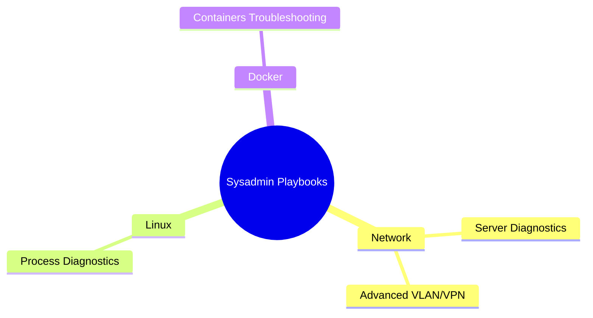

# 🛠️ Sysadmin Playbooks Collection
## Навигация по репозиторию

📡 Network | 🖥️ Linux | 🐳 Docker | 🌐 Advanced Networking  
### Diagnose faster, fix smarter

Коллекция практических README-шпаргалок для системных администраторов и DevOps.  
Каждый документ — это готовый playbook для диагностики и устранения проблем: сеть, процессы, контейнеры, продвинутые сетевые функции.

---

## 📚 Содержание

- 📡 [Server Network Diagnostics](./server-network-diagnostics.md)  
- 🖥️ [Linux Process & System Diagnostics](./linux-process-diagnostics.md)  
- 🐳 [Docker & Containers Troubleshooting](./docker-containers-troubleshooting.md)  
- 🌐 [Networking Advanced (VLAN, VPN, Tunnels)](./networking-advanced.md)  

---

## 🎯 Цель

- 📊 Дать системным администраторам и DevOps быстрые чеклисты.  
- ⚡ Обеспечить алгоритмы диагностики "от простого к сложному".  
- 🧩 Предоставить реальные кейсы и примеры команд.  
- 📈 Сделать документацию красивой и понятной для портфолио.  

---

## 🚀 Как использовать

1. Откройте нужный playbook.  
2. Следуйте пошаговым алгоритмам и командам.  
3. Используйте Quick Reference для экстренной диагностики.  
4. Применяйте Usage-кейсы для реальных инцидентов.  

---

## 🔖 Теги (GitHub Topics)

`devops` · `sysadmin` · `linux` · `troubleshooting` · `cheatsheet` · `playbook` · `networking` · `docker` · `monitoring`

---

## 📜 License

Свободно использовать и адаптировать для учебных и рабочих целей.

